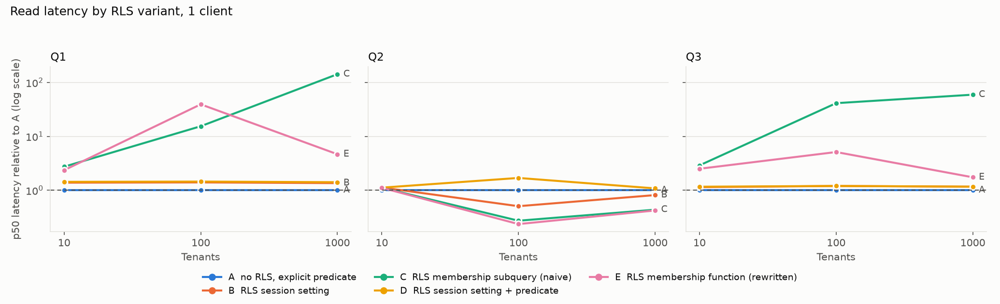
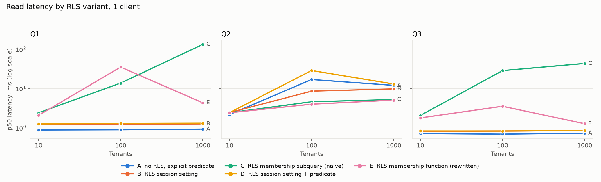
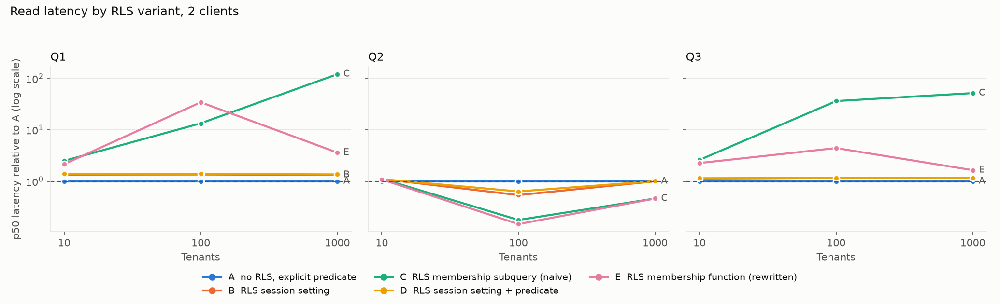
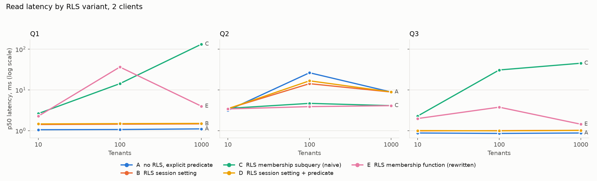
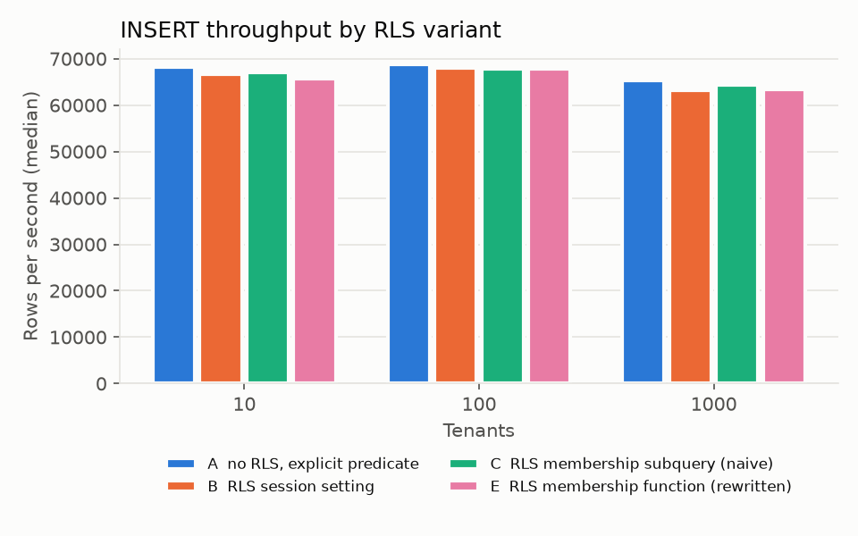

# Benchmark report (generated)

Generated from the summary files in this directory by `bench/report.py`. Numbers only; the answer, recommendation and limitations are written separately.

## Environment

| Item | Value |
|---|---|
| PostgreSQL | PostgreSQL 16.15 on x86_64-pc-linux-musl |
| TimescaleDB | 2.30.2 |
| pgbench (client) | pgbench (PostgreSQL) 18.6 (Ubuntu 18.6-0ubuntu0.26.04.1) |
| Platform | Linux-7.0.0-22-generic-x86_64-with-glibc2.43 |
| vCPUs (as seen by the OS) | 2 |
| RAM | 7.7 GiB |
| shared_buffers / effective_cache_size | 2.0 GB / 5.0 GB |
| work_mem / max_wal_size | 32 MB / 4096MB |
| synchronous_commit / jit | on / off |
| Run tag | 20261020-175648 |
| Captured | 2026-10-20T17:56:48+00:00 |

VM details (from `vm_environment.txt`):

```
image: timescale/timescaledb@sha256:6f139d56042989bd35f50ba5986e492cd32e35cc6778c50be2659add298dc09f
kernel: Linux 7.0.0-22-generic x86_64
os: Ubuntu 26.04 LTS
pgbench: pgbench (PostgreSQL) 18.6 (Ubuntu 18.6-0ubuntu0.26.04.1)
python: Python 3.14.4
docker: Docker version 29.1.3, build 29.1.3-0ubuntu4.1
CPU(s):                                  2
Model name:                              AMD EPYC 7C13 64-Core Processor
Thread(s) per core:                      1
Core(s) per socket:                      1
               total        used        free      shared  buff/cache   available
Mem:           7.7Gi       1.0Gi       3.2Gi        67Mi       3.9Gi       6.8Gi
/dev/sda2        99G  4.9G   89G   6% /
commit: 4473f22e89110659c8f2223ad97630f67f3e7e2b
```

## Dataset

| Tenants | Rows | Size (MB) | Bytes per row | Load (s) |
|---|---|---|---|---|
| 10 | 20,100,161 | 4,313 | 214.6 | 243.6 |
| 100 | 20,100,160 | 4,175 | 207.7 | 257.8 |
| 1000 | 20,100,155 | 3,566 | 177.4 | 263.0 |

## Read latency (Tests 2 and 4)

Each cell is the median of the measured runs, with the min to max range in brackets. `x A` is the median p50 divided by variant A's median p50 at the same tenant count; A is the no-RLS baseline. Latencies are in milliseconds per transaction.

### Q1, 1 client, simple protocol

**p50**

| Variant | 10 tenants | 100 tenants | 1000 tenants |
|---|---|---|---|
| A  no RLS, explicit predicate | 0.88 (0.88-0.90) | 0.90 (0.89-0.91) | 0.93 (0.92-0.94) |
| B  RLS session setting | 1.22 (1.21-1.24) 1.38x A | 1.25 (1.22-1.29) 1.40x A | 1.26 (1.25-1.28) 1.36x A |
| C  RLS membership subquery (naive) | 2.42 (2.41-2.46) 2.73x A | 13.80 (13.58-13.88) 15.40x A | 132.53 (132.10-132.96) 142.20x A |
| D  RLS session setting + predicate | 1.27 (1.26-1.30) 1.43x A | 1.30 (1.27-1.31) 1.45x A | 1.31 (1.29-1.32) 1.41x A |
| E  RLS membership function (rewritten) | 2.08 (2.06-2.17) 2.36x A | 35.17 (31.69-45.23) 39.25x A | 4.34 (4.00-5.89) 4.66x A |

**p95**

| Variant | 10 tenants | 100 tenants | 1000 tenants |
|---|---|---|---|
| A  no RLS, explicit predicate | 0.97 (0.94-0.99) | 1.00 (0.99-1.00) | 1.02 (1.00-1.05) |
| B  RLS session setting | 1.36 (1.29-1.40) | 1.39 (1.31-1.42) | 1.38 (1.34-1.41) |
| C  RLS membership subquery (naive) | 2.63 (2.59-2.66) | 14.91 (14.49-15.34) | 143.60 (140.27-146.27) |
| D  RLS session setting + predicate | 1.40 (1.38-1.46) | 1.42 (1.38-1.45) | 1.44 (1.40-1.46) |
| E  RLS membership function (rewritten) | 2.27 (2.25-2.29) | 208.36 (61.55-261.37) | 7.68 (7.01-8.39) |

**p99**

| Variant | 10 tenants | 100 tenants | 1000 tenants |
|---|---|---|---|
| A  no RLS, explicit predicate | 1.20 (1.11-1.27) | 1.22 (1.09-1.28) | 1.28 (1.15-1.37) |
| B  RLS session setting | 1.63 (1.49-1.70) | 1.74 (1.43-1.88) | 1.65 (1.51-1.73) |
| C  RLS membership subquery (naive) | 3.08 (2.95-3.58) | 16.64 (15.96-17.49) | 157.38 (150.83-159.73) |
| D  RLS session setting + predicate | 1.75 (1.62-1.82) | 1.84 (1.57-1.88) | 1.75 (1.56-1.91) |
| E  RLS membership function (rewritten) | 2.57 (2.43-3.35) | 763.12 (82.16-917.33) | 9.62 (9.35-10.62) |

### Q1, 2 clients, simple protocol

**p50**

| Variant | 10 tenants | 100 tenants | 1000 tenants |
|---|---|---|---|
| A  no RLS, explicit predicate | 1.05 (1.05-1.06) | 1.07 (1.03-1.08) | 1.11 (1.08-1.12) |
| B  RLS session setting | 1.42 (1.41-1.44) 1.35x A | 1.45 (1.44-1.47) 1.35x A | 1.47 (1.44-1.48) 1.33x A |
| C  RLS membership subquery (naive) | 2.63 (2.59-2.64) 2.49x A | 14.28 (14.06-14.49) 13.37x A | 133.17 (132.86-137.60) 120.30x A |
| D  RLS session setting + predicate | 1.47 (1.45-1.50) 1.39x A | 1.49 (1.48-1.51) 1.39x A | 1.51 (1.50-1.53) 1.36x A |
| E  RLS membership function (rewritten) | 2.27 (2.24-2.29) 2.15x A | 36.59 (30.41-38.68) 34.26x A | 3.98 (3.83-4.07) 3.60x A |

**p95**

| Variant | 10 tenants | 100 tenants | 1000 tenants |
|---|---|---|---|
| A  no RLS, explicit predicate | 1.41 (1.37-1.43) | 1.38 (1.31-1.49) | 1.45 (1.39-1.52) |
| B  RLS session setting | 1.76 (1.73-1.82) | 1.79 (1.75-1.84) | 1.78 (1.75-1.81) |
| C  RLS membership subquery (naive) | 2.95 (2.87-3.04) | 15.85 (15.56-16.62) | 151.27 (144.36-153.62) |
| D  RLS session setting + predicate | 1.78 (1.77-1.85) | 1.81 (1.75-1.85) | 1.83 (1.80-1.84) |
| E  RLS membership function (rewritten) | 2.58 (2.52-2.59) | 67.56 (49.64-68.63) | 7.07 (6.11-8.21) |

**p99**

| Variant | 10 tenants | 100 tenants | 1000 tenants |
|---|---|---|---|
| A  no RLS, explicit predicate | 1.93 (1.85-1.98) | 1.90 (1.74-1.97) | 2.01 (1.87-2.04) |
| B  RLS session setting | 2.47 (2.42-2.84) | 2.53 (2.43-2.58) | 2.55 (2.48-2.69) |
| C  RLS membership subquery (naive) | 4.25 (3.94-4.54) | 22.01 (20.01-25.03) | 177.79 (173.11-182.09) |
| D  RLS session setting + predicate | 2.50 (2.42-2.60) | 2.58 (2.41-2.60) | 2.60 (2.39-2.61) |
| E  RLS membership function (rewritten) | 3.49 (3.34-3.69) | 79.03 (59.85-81.89) | 10.09 (8.59-11.15) |

### Q2, 1 client, simple protocol

**p50**

| Variant | 10 tenants | 100 tenants | 1000 tenants |
|---|---|---|---|
| A  no RLS, explicit predicate | 2.18 (2.12-2.22) | 16.98 (9.93-23.29) | 12.06 (8.88-13.40) |
| B  RLS session setting | 2.45 (2.42-2.67) 1.12x A | 8.60 (8.42-27.38) 0.51x A | 9.81 (7.66-13.13) 0.81x A |
| C  RLS membership subquery (naive) | 2.43 (2.39-2.53) 1.11x A | 4.62 (3.92-6.90) 0.27x A | 5.26 (5.17-5.51) 0.44x A |
| D  RLS session setting + predicate | 2.44 (2.39-2.50) 1.12x A | 28.74 (14.47-43.12) 1.69x A | 13.05 (8.89-13.52) 1.08x A |
| E  RLS membership function (rewritten) | 2.42 (2.38-2.44) 1.11x A | 4.00 (3.80-4.14) 0.24x A | 5.08 (4.98-5.21) 0.42x A |

**p95**

| Variant | 10 tenants | 100 tenants | 1000 tenants |
|---|---|---|---|
| A  no RLS, explicit predicate | 2.70 (2.67-3.66) | 107.92 (84.33-121.09) | 20.04 (18.73-21.59) |
| B  RLS session setting | 2.90 (2.83-5.01) | 63.02 (57.72-104.73) | 18.80 (16.24-20.92) |
| C  RLS membership subquery (naive) | 5.22 (4.91-5.83) | 42.18 (35.73-119.04) | 12.31 (11.99-14.24) |
| D  RLS session setting + predicate | 3.50 (2.93-4.24) | 80.55 (77.14-91.46) | 20.50 (17.43-21.24) |
| E  RLS membership function (rewritten) | 2.84 (2.80-4.08) | 5.96 (5.81-6.20) | 7.08 (6.76-7.41) |

**p99**

| Variant | 10 tenants | 100 tenants | 1000 tenants |
|---|---|---|---|
| A  no RLS, explicit predicate | 3.77 (3.25-5.09) | 171.63 (146.67-185.28) | 24.63 (23.68-26.25) |
| B  RLS session setting | 3.43 (3.34-7.11) | 105.90 (89.93-170.79) | 23.68 (21.33-24.32) |
| C  RLS membership subquery (naive) | 8.30 (7.50-8.67) | 134.75 (121.75-190.40) | 21.55 (20.15-23.00) |
| D  RLS session setting + predicate | 4.65 (4.02-6.01) | 115.08 (102.67-143.34) | 25.91 (22.51-26.65) |
| E  RLS membership function (rewritten) | 3.90 (3.45-5.55) | 8.68 (8.18-8.84) | 9.08 (8.33-9.80) |

### Q2, 2 clients, simple protocol

**p50**

| Variant | 10 tenants | 100 tenants | 1000 tenants |
|---|---|---|---|
| A  no RLS, explicit predicate | 3.15 (3.10-3.21) | 26.47 (18.56-33.26) | 8.90 (8.19-9.38) |
| B  RLS session setting | 3.49 (3.43-3.58) 1.11x A | 14.27 (13.59-23.20) 0.54x A | 8.89 (8.42-9.98) 1.00x A |
| C  RLS membership subquery (naive) | 3.53 (3.41-3.63) 1.12x A | 4.68 (4.47-5.20) 0.18x A | 4.12 (4.10-4.23) 0.46x A |
| D  RLS session setting + predicate | 3.46 (3.39-3.49) 1.10x A | 16.79 (15.40-19.36) 0.63x A | 8.95 (8.63-9.52) 1.01x A |
| E  RLS membership function (rewritten) | 3.42 (3.39-3.55) 1.08x A | 3.90 (3.82-4.05) 0.15x A | 4.11 (4.08-4.22) 0.46x A |

**p95**

| Variant | 10 tenants | 100 tenants | 1000 tenants |
|---|---|---|---|
| A  no RLS, explicit predicate | 4.65 (4.57-4.86) | 197.32 (118.26-226.76) | 22.81 (21.57-24.17) |
| B  RLS session setting | 5.06 (4.90-5.45) | 116.22 (103.10-211.78) | 22.20 (19.93-23.97) |
| C  RLS membership subquery (naive) | 5.40 (5.23-5.46) | 6.83 (6.49-7.77) | 8.79 (8.35-9.25) |
| D  RLS session setting + predicate | 4.97 (4.88-5.21) | 148.20 (134.82-191.84) | 24.26 (22.06-24.88) |
| E  RLS membership function (rewritten) | 4.94 (4.91-5.39) | 6.19 (5.95-6.26) | 8.64 (8.37-9.67) |

**p99**

| Variant | 10 tenants | 100 tenants | 1000 tenants |
|---|---|---|---|
| A  no RLS, explicit predicate | 5.76 (5.30-6.30) | 321.92 (186.45-380.85) | 30.30 (28.58-34.76) |
| B  RLS session setting | 6.21 (5.83-7.82) | 218.04 (175.83-299.93) | 30.49 (26.94-31.18) |
| C  RLS membership subquery (naive) | 6.93 (6.56-7.31) | 8.65 (7.99-14.12) | 12.28 (11.48-13.08) |
| D  RLS session setting + predicate | 6.04 (5.79-6.71) | 257.54 (211.57-283.75) | 31.51 (28.23-33.20) |
| E  RLS membership function (rewritten) | 5.92 (5.71-6.93) | 7.58 (7.43-7.76) | 11.96 (11.35-13.62) |

### Q3, 1 client, simple protocol

**p50**

| Variant | 10 tenants | 100 tenants | 1000 tenants |
|---|---|---|---|
| A  no RLS, explicit predicate | 0.72 (0.70-0.73) | 0.69 (0.68-0.71) | 0.73 (0.73-0.74) |
| B  RLS session setting | 0.82 (0.82-0.83) 1.14x A | 0.83 (0.83-0.84) 1.20x A | 0.85 (0.84-0.87) 1.16x A |
| C  RLS membership subquery (naive) | 2.08 (2.06-2.09) 2.89x A | 28.58 (27.68-29.73) 41.25x A | 43.51 (43.10-44.66) 59.28x A |
| D  RLS session setting + predicate | 0.83 (0.83-0.84) 1.16x A | 0.83 (0.81-0.84) 1.20x A | 0.86 (0.85-0.87) 1.17x A |
| E  RLS membership function (rewritten) | 1.79 (1.76-1.80) 2.50x A | 3.55 (3.43-3.75) 5.12x A | 1.28 (1.24-1.29) 1.74x A |

**p95**

| Variant | 10 tenants | 100 tenants | 1000 tenants |
|---|---|---|---|
| A  no RLS, explicit predicate | 0.79 (0.77-0.83) | 0.79 (0.76-0.82) | 1.06 (0.93-1.07) |
| B  RLS session setting | 0.90 (0.89-0.91) | 0.93 (0.91-0.94) | 1.23 (1.17-1.27) |
| C  RLS membership subquery (naive) | 2.27 (2.20-2.33) | 31.41 (29.99-32.61) | 47.01 (45.24-47.99) |
| D  RLS session setting + predicate | 0.90 (0.89-0.94) | 0.91 (0.91-0.94) | 1.23 (1.06-1.25) |
| E  RLS membership function (rewritten) | 1.93 (1.89-1.98) | 5.61 (4.42-6.57) | 2.03 (1.99-2.09) |

**p99**

| Variant | 10 tenants | 100 tenants | 1000 tenants |
|---|---|---|---|
| A  no RLS, explicit predicate | 0.97 (0.86-1.02) | 1.00 (0.96-1.10) | 1.79 (1.65-1.93) |
| B  RLS session setting | 1.11 (0.98-1.14) | 1.22 (1.15-1.30) | 2.09 (1.99-2.40) |
| C  RLS membership subquery (naive) | 2.78 (2.43-3.16) | 37.49 (35.23-38.33) | 50.07 (49.55-63.11) |
| D  RLS session setting + predicate | 1.09 (1.00-1.23) | 1.22 (1.15-1.27) | 2.12 (1.94-2.17) |
| E  RLS membership function (rewritten) | 2.43 (2.11-2.88) | 8.55 (6.44-9.90) | 3.25 (2.97-4.09) |

### Q3, 2 clients, simple protocol

**p50**

| Variant | 10 tenants | 100 tenants | 1000 tenants |
|---|---|---|---|
| A  no RLS, explicit predicate | 0.88 (0.87-0.88) | 0.86 (0.84-0.86) | 0.88 (0.87-0.89) |
| B  RLS session setting | 0.99 (0.98-0.99) 1.13x A | 1.00 (0.99-1.01) 1.17x A | 1.02 (1.01-1.03) 1.16x A |
| C  RLS membership subquery (naive) | 2.28 (2.26-2.31) 2.60x A | 30.95 (29.51-31.62) 36.16x A | 45.31 (43.95-46.03) 51.66x A |
| D  RLS session setting + predicate | 1.00 (0.99-1.01) 1.14x A | 0.99 (0.97-1.00) 1.16x A | 1.01 (1.00-1.02) 1.16x A |
| E  RLS membership function (rewritten) | 1.98 (1.98-2.00) 2.26x A | 3.78 (3.70-3.94) 4.41x A | 1.44 (1.40-1.45) 1.64x A |

**p95**

| Variant | 10 tenants | 100 tenants | 1000 tenants |
|---|---|---|---|
| A  no RLS, explicit predicate | 1.21 (1.18-1.24) | 1.20 (1.18-1.24) | 1.21 (1.20-1.24) |
| B  RLS session setting | 1.29 (1.26-1.34) | 1.34 (1.32-1.43) | 1.36 (1.30-1.41) |
| C  RLS membership subquery (naive) | 2.60 (2.58-2.66) | 34.54 (33.65-36.28) | 48.43 (47.56-50.42) |
| D  RLS session setting + predicate | 1.32 (1.30-1.39) | 1.35 (1.29-1.36) | 1.35 (1.32-1.38) |
| E  RLS membership function (rewritten) | 2.27 (2.24-2.33) | 4.28 (4.23-4.55) | 1.77 (1.70-1.86) |

**p99**

| Variant | 10 tenants | 100 tenants | 1000 tenants |
|---|---|---|---|
| A  no RLS, explicit predicate | 1.56 (1.55-1.72) | 1.56 (1.53-1.60) | 1.59 (1.53-1.60) |
| B  RLS session setting | 1.73 (1.65-1.80) | 1.77 (1.73-1.83) | 1.83 (1.71-1.88) |
| C  RLS membership subquery (naive) | 3.75 (3.40-3.77) | 42.87 (41.52-45.45) | 64.11 (61.12-66.00) |
| D  RLS session setting + predicate | 1.74 (1.69-1.89) | 1.76 (1.72-1.78) | 1.82 (1.75-1.95) |
| E  RLS membership function (rewritten) | 3.24 (3.06-3.31) | 5.60 (5.40-6.17) | 2.55 (2.50-2.78) |

## Query plans (Test 4)

One EXPLAIN (ANALYZE, BUFFERS) per variant, query and tenant count, taken in the first repetition. Full plan JSON is in `plans/`.

| Query | Tenants | Variant | Scan nodes on telemetry | Chunks scanned | Seq scan | Exec ms | Indexes |
|---|---|---|---|---|---|---|---|
| Q1 | 10 | A | Custom Scan, Index Scan | 1 | no | 2.22 | ~6_189_chunk_telemetry_tenant_device_time |
| Q1 | 10 | B | Custom Scan, Index Scan | 7 | no | 0.68 | ~6_183_chunk_telemetry_tenant_device_time, ~6_184_chunk_telemetry_tena |
| Q1 | 10 | C | Custom Scan, Index Scan | 7 | no | 45.10 | ~6_183_chunk_telemetry_time_idx, ~6_184_chunk_telemetry_time_idx, ~6_1 |
| Q1 | 10 | D | Custom Scan, Index Scan | 7 | no | 0.65 | ~6_183_chunk_telemetry_tenant_device_time, ~6_184_chunk_telemetry_tena |
| Q1 | 10 | E | Custom Scan, Index Scan | 7 | no | 2.03 | ~6_183_chunk_telemetry_time_idx, ~6_184_chunk_telemetry_time_idx, ~6_1 |
| Q1 | 100 | A | Custom Scan, Index Scan | 1 | no | 2.51 | ~7_196_chunk_telemetry_tenant_device_time |
| Q1 | 100 | B | Custom Scan, Index Scan | 7 | no | 0.80 | ~7_190_chunk_telemetry_tenant_device_time, ~7_191_chunk_telemetry_tena |
| Q1 | 100 | C | Custom Scan, Index Scan | 7 | no | 53.94 | ~7_190_chunk_telemetry_time_idx, ~7_191_chunk_telemetry_time_idx, ~7_1 |
| Q1 | 100 | D | Custom Scan, Index Scan | 7 | no | 0.73 | ~7_190_chunk_telemetry_tenant_device_time, ~7_191_chunk_telemetry_tena |
| Q1 | 100 | E | Custom Scan, Index Scan | 7 | no | 936.87 | ~7_190_chunk_telemetry_tenant_device_time, ~7_191_chunk_telemetry_tena |
| Q1 | 1000 | A | Custom Scan, Index Scan | 1 | no | 2.55 | ~8_203_chunk_telemetry_tenant_device_time |
| Q1 | 1000 | B | Custom Scan, Index Scan | 7 | no | 0.56 | ~8_197_chunk_telemetry_tenant_device_time, ~8_198_chunk_telemetry_tena |
| Q1 | 1000 | C | Custom Scan, Index Scan | 7 | no | 384.28 | ~8_197_chunk_telemetry_time_idx, ~8_198_chunk_telemetry_time_idx, ~8_1 |
| Q1 | 1000 | D | Custom Scan, Index Scan | 7 | no | 0.88 | ~8_197_chunk_telemetry_tenant_device_time, ~8_198_chunk_telemetry_tena |
| Q1 | 1000 | E | Custom Scan, Index Scan | 7 | no | 7.12 | ~8_197_chunk_telemetry_tenant_device_time, ~8_198_chunk_telemetry_tena |
| Q2 | 10 | A | Custom Scan, Index Scan | 7 | no | 46.66 | ~6_183_chunk_telemetry_mission_time, ~6_184_chunk_telemetry_mission_ti |
| Q2 | 10 | B | Custom Scan, Index Scan | 7 | no | 7.42 | ~6_183_chunk_telemetry_mission_time, ~6_184_chunk_telemetry_mission_ti |
| Q2 | 10 | C | Custom Scan, Index Scan | 7 | no | 7.97 | ~6_183_chunk_telemetry_mission_time, ~6_184_chunk_telemetry_mission_ti |
| Q2 | 10 | D | Custom Scan, Index Scan | 7 | no | 3.11 | ~6_183_chunk_telemetry_mission_time, ~6_184_chunk_telemetry_mission_ti |
| Q2 | 10 | E | Custom Scan, Index Scan | 7 | no | 2.17 | ~6_183_chunk_telemetry_mission_time, ~6_184_chunk_telemetry_mission_ti |
| Q2 | 100 | A | Bitmap Heap Scan | 7 | no | 39.51 | ~7_190_chunk_telemetry_mission_time, ~7_190_chunk_telemetry_tenant_dev |
| Q2 | 100 | B | Bitmap Heap Scan, Custom Scan | 7 | no | 122.08 | ~7_190_chunk_telemetry_mission_time, ~7_190_chunk_telemetry_tenant_dev |
| Q2 | 100 | C | Custom Scan, Index Scan | 7 | no | 97.06 | ~7_190_chunk_telemetry_mission_time, ~7_191_chunk_telemetry_mission_ti |
| Q2 | 100 | D | Bitmap Heap Scan, Custom Scan | 7 | no | 44.49 | ~7_190_chunk_telemetry_mission_time, ~7_190_chunk_telemetry_tenant_dev |
| Q2 | 100 | E | Custom Scan, Index Scan | 7 | no | 8.56 | ~7_190_chunk_telemetry_mission_time, ~7_191_chunk_telemetry_mission_ti |
| Q2 | 1000 | A | Bitmap Heap Scan | 7 | no | 6.41 | ~8_197_chunk_telemetry_mission_time, ~8_197_chunk_telemetry_tenant_dev |
| Q2 | 1000 | B | Bitmap Heap Scan, Custom Scan | 7 | no | 17.76 | ~8_197_chunk_telemetry_mission_time, ~8_197_chunk_telemetry_tenant_dev |
| Q2 | 1000 | C | Custom Scan, Index Scan | 7 | no | 11.10 | ~8_197_chunk_telemetry_mission_time, ~8_198_chunk_telemetry_mission_ti |
| Q2 | 1000 | D | Bitmap Heap Scan, Custom Scan | 7 | no | 18.43 | ~8_197_chunk_telemetry_mission_time, ~8_197_chunk_telemetry_tenant_dev |
| Q2 | 1000 | E | Custom Scan, Index Scan | 7 | no | 9.86 | ~8_197_chunk_telemetry_mission_time, ~8_198_chunk_telemetry_mission_ti |
| Q3 | 10 | A | Index Scan | 1 | no | 2.93 | ~6_189_chunk_telemetry_tenant_device_time |
| Q3 | 10 | B | Custom Scan, Index Scan | 1 | no | 0.59 | ~6_189_chunk_telemetry_tenant_device_time |
| Q3 | 10 | C | Custom Scan, Index Scan | 1 | no | 3.81 | ~6_189_chunk_telemetry_time_idx, memberships_pkey |
| Q3 | 10 | D | Custom Scan, Index Scan | 1 | no | 0.56 | ~6_189_chunk_telemetry_tenant_device_time |
| Q3 | 10 | E | Custom Scan, Index Scan | 1 | no | 4.08 | ~6_189_chunk_telemetry_time_idx |
| Q3 | 100 | A | Index Scan | 1 | no | 2.65 | ~7_196_chunk_telemetry_tenant_device_time |
| Q3 | 100 | B | Custom Scan, Index Scan | 1 | no | 34.73 | ~7_196_chunk_telemetry_tenant_device_time |
| Q3 | 100 | C | Custom Scan, Index Scan | 1 | no | 56.49 | ~7_196_chunk_telemetry_time_idx, memberships_pkey |
| Q3 | 100 | D | Custom Scan, Index Scan | 1 | no | 34.80 | ~7_196_chunk_telemetry_tenant_device_time |
| Q3 | 100 | E | Custom Scan, Index Scan | 1 | no | 20.02 | ~7_196_chunk_telemetry_tenant_device_time |
| Q3 | 1000 | A | Index Scan | 1 | no | 17.14 | ~8_203_chunk_telemetry_tenant_device_time |
| Q3 | 1000 | B | Custom Scan, Index Scan | 1 | no | 7.58 | ~8_203_chunk_telemetry_tenant_device_time |
| Q3 | 1000 | C | Custom Scan, Index Scan | 1 | no | 916.25 | ~8_203_chunk_telemetry_tenant_device_time, memberships_pkey |
| Q3 | 1000 | D | Custom Scan, Index Scan | 1 | no | 12.09 | ~8_203_chunk_telemetry_tenant_device_time |
| Q3 | 1000 | E | Custom Scan, Index Scan | 1 | no | 4.51 | ~8_203_chunk_telemetry_tenant_device_time |

## Write throughput with and without RLS (Test 3)

INSERT only (COPY is not allowed on RLS tables). Median rows per second with the min to max range; `x A` is relative to variant A at the same tenant count and writer count.

| Tenants | Writers | Batch | A | B | C | E |
|---|---|---|---|---|---|---|
| 10 | 2 | 1000 | 68,143 (67,876-69,424) | 66,631 (66,257-68,281) 0.98x A | 67,031 (66,439-67,387) 0.98x A | 65,695 (65,197-66,595) 0.96x A |
| 100 | 2 | 1000 | 68,727 (67,813-68,828) | 68,102 (66,389-70,096) 0.99x A | 67,746 (66,347-68,884) 0.99x A | 67,800 (67,395-68,873) 0.99x A |
| 1000 | 2 | 1000 | 65,250 (63,195-65,512) | 63,287 (61,718-65,085) 0.97x A | 64,321 (62,660-64,421) 0.99x A | 63,330 (61,755-63,824) 0.97x A |

## Ingest baseline (Test 1)

No RLS. Median rows per second (min to max) and batch p95 latency in milliseconds.

| Method | Batch size | Writers | Rows/s | Batch p95 ms |
|---|---|---|---|---|
| copy | 500 | 1 | 88,188 (87,322-88,649) | 7.2 |
| copy | 500 | 2 | 146,173 (140,889-149,725) | 9.9 |
| copy | 500 | 4 | 148,558 (144,303-165,443) | 19.0 |
| copy | 2000 | 1 | 105,254 (104,105-108,233) | 23.7 |
| copy | 2000 | 2 | 169,335 (166,536-175,560) | 29.5 |
| copy | 2000 | 4 | 169,177 (164,039-179,788) | 64.0 |
| copy | 10000 | 1 | 115,008 (112,713-116,602) | 99.3 |
| copy | 10000 | 2 | 182,733 (177,984-191,463) | 122.4 |
| copy | 10000 | 4 | 185,196 (182,340-190,091) | 284.5 |
| insert | 500 | 1 | 34,581 (34,436-34,824) | 16.6 |
| insert | 500 | 2 | 64,270 (63,098-65,110) | 21.0 |
| insert | 500 | 4 | 62,865 (62,647-65,231) | 47.4 |
| insert | 2000 | 1 | 36,721 (36,661-36,815) | 62.3 |
| insert | 2000 | 2 | 68,370 (67,668-69,724) | 70.8 |
| insert | 2000 | 4 | 68,716 (66,305-69,122) | 162.6 |
| insert | 10000 | 1 | 38,546 (38,040-38,847) | 280.3 |
| insert | 10000 | 2 | 72,600 (68,885-74,482) | 334.0 |
| insert | 10000 | 4 | 73,740 (71,689-74,782) | 714.0 |

## Prepared-statement subset

Each cell is the median of the measured runs, with the min to max range in brackets. `x A` is the median p50 divided by variant A's median p50 at the same tenant count; A is the no-RLS baseline. Latencies are in milliseconds per transaction.

### Q1, 1 client, prepared protocol

**p50**

| Variant | 100 tenants |
|---|---|
| A  no RLS, explicit predicate | 0.99 (0.99-1.00) |
| B  RLS session setting | 0.71 (0.71-0.73) 0.72x A |
| E  RLS membership function (rewritten) | 21.24 (18.92-56.94) 21.37x A |

**p95**

| Variant | 100 tenants |
|---|---|
| A  no RLS, explicit predicate | 1.11 (1.11-1.13) |
| B  RLS session setting | 0.83 (0.81-0.84) |
| E  RLS membership function (rewritten) | 58.62 (22.42-71.44) |

**p99**

| Variant | 100 tenants |
|---|---|
| A  no RLS, explicit predicate | 1.41 (1.40-1.43) |
| B  RLS session setting | 0.97 (0.96-1.01) |
| E  RLS membership function (rewritten) | 68.19 (31.20-81.42) |

### Q3, 1 client, prepared protocol

**p50**

| Variant | 100 tenants |
|---|---|
| A  no RLS, explicit predicate | 0.86 (0.86-0.86) |
| B  RLS session setting | 0.93 (0.92-0.94) 1.09x A |
| E  RLS membership function (rewritten) | 3.63 (3.48-3.69) 4.22x A |

**p95**

| Variant | 100 tenants |
|---|---|
| A  no RLS, explicit predicate | 0.97 (0.97-0.97) |
| B  RLS session setting | 1.03 (1.02-1.06) |
| E  RLS membership function (rewritten) | 4.12 (3.94-4.14) |

**p99**

| Variant | 100 tenants |
|---|---|
| A  no RLS, explicit predicate | 1.14 (1.13-1.19) |
| B  RLS session setting | 1.20 (1.20-1.29) |
| E  RLS membership function (rewritten) | 4.71 (4.53-5.17) |

## CPU steal time

Percentage of time the VM's CPU was taken by the hypervisor (vmstat `st`, one sample per second). Sustained values above a few percent mean other tenants affected the measurements.

| Log | Samples | Mean % | p99 % | Max % |
|---|---|---|---|---|
| official/sysstat_20261020-141827.log | 11850 | 0.01 | 0 | 1 |
| official/sysstat_ingest_20261020-173601.log | 1246 | 0.01 | 0 | 1 |
| official/sysstat_ingest_20261020-175648.log | 1633 | 0.01 | 0 | 1 |
| official_prepared/sysstat_20261020-182402.log | 747 | 0.01 | 0 | 1 |

## Charts










